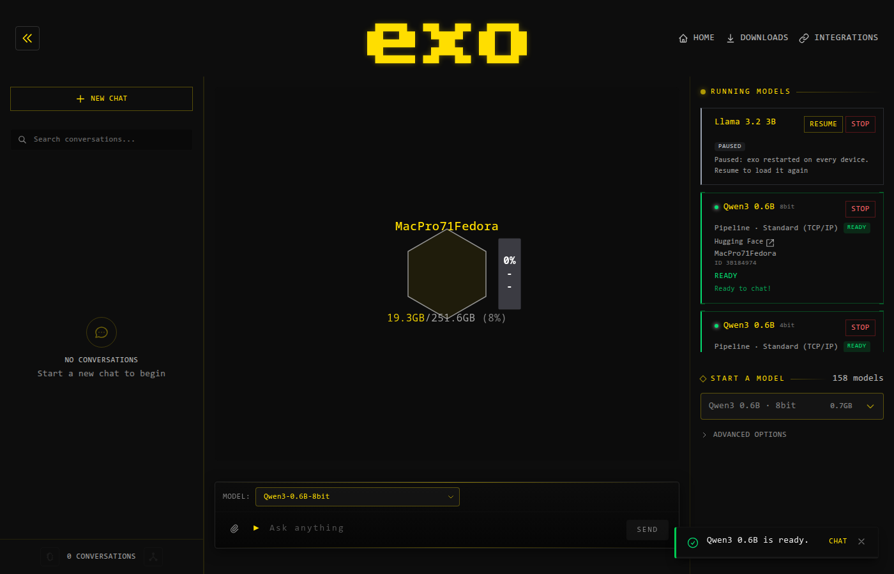

# exo on a Mac Pro 7,1 running Fedora (x86_64)

This directory records how exo was brought up on this machine, what works, what does not, and
what the numbers are. The short version:

- exo **builds and runs** here: one node, master + worker, the dashboard and API on
  `http://localhost:52415`, and the OpenAI-compatible endpoints.
- exo **runs models** here through MLX's Linux CPU backend (`exo[mlx-cpu]`), on the CPU only.
- Inference is **correct but slow**: 2.3 tok/s decode for a 0.6B 4-bit model. exo loads models for
  a CPU in `float32`, which MLX's x86 backend prefers — `float16` is emulated there and made the
  same model 8× slower. See [STATUS.md](STATUS.md#inference-speed).

The machine has three AMD GPUs, and exo cannot use any of them: MLX has no ROCm backend, and
exo's only other engine (`vllm`) targets CUDA. The CPU is therefore the whole story here.

## The machine

| | |
|---|---|
| Host | Mac Pro 7,1, Fedora Linux 44 (KDE Plasma Desktop), kernel 7.2.15 |
| CPU | Intel Xeon W-3275, 28 cores / 56 threads, 2.5 GHz base |
| RAM | 251 GiB |
| GPUs | 2 × Radeon Pro W6800X, 1 × Radeon Pro Vega II (ROCm 7.1.1 runtime installed, no `hipcc`) |
| Python | 3.13.9 |
| exo | 0.3.70, wire version 7 |

## Quick start

`. macpro71fedora/scripts/env.sh` first: it points the build and the node at writable directories
inside the workspace, since `$HOME` is read-only here, and names the interpreter to build with.

```bash
# 1. build the Rust extension and the Python environment (MLX CPU backend)
uv sync --locked --python "$PYTHON" --extra mlx-cpu --all-packages

# 2. build the dashboard (only needed once, and after dashboard changes)
(cd dashboard && npm install && npm run build)

# 3. run a node
uv run exo            # dashboard + API on http://localhost:52415

# 4. run a model
curl -X POST http://localhost:52415/place_instance \
  -H 'Content-Type: application/json' \
  -d '{"model_id":"mlx-community/Qwen3-0.6B-4bit"}'

# 5. talk to it
curl -X POST http://localhost:52415/v1/chat/completions \
  -H 'Content-Type: application/json' \
  -d '{"model":"mlx-community/Qwen3-0.6B-4bit",
       "messages":[{"role":"user","content":"Say hello in five words."}],
       "max_tokens":16}'
```

Build the virtualenv from a standalone CPython (`uv python install 3.13`, which `$PYTHON`
points at), not from a conda one: conda's interpreter has `DT_RPATH=$ORIGIN/../lib`, which pins
`libstdc++` to conda's copy — too old for MLX — in any process that loads it, and the runner
subprocess is such a process. [STATUS.md](STATUS.md#build-environment) has the details, along with
the sandbox's read-only `$HOME`.

## Scripts

| Script | What it does |
|---|---|
| `scripts/env.sh` | Exports the environment a node and the benchmarks need (XDG dirs, model dir, `uv`, `LD_PRELOAD`). |
| `scripts/start-node.sh` | Starts one node in the background, logging to `logs/exo.log`. |
| `scripts/stop-node.sh` | Stops the node started by `start-node.sh`. |
| `scripts/smoke.sh` | Places a model and asks it one question; prints the reply and the time taken. |
| `scripts/bench-primitives.py` | Times the MLX primitives decode is built from, per dtype. |
| `scripts/bench-model.py` | Times a whole model's forward pass and decode steps. |



## Where the work stands

`STATUS.md` has the session record: what was changed, every number quoted here, the root causes
behind the two performance cliffs, and what would move each of them.
