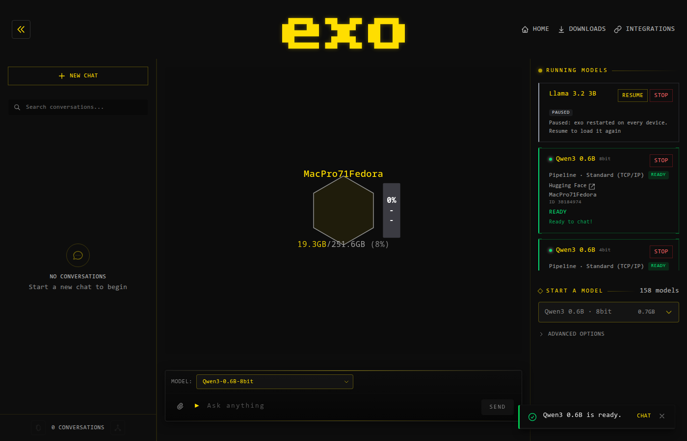

# exo on Mac Pro 7,1 / Fedora — session record

Everything here was measured on this machine. Numbers are wall-clock, on an idle node, with the
node and the benchmark both running on the CPU.

- Host: `MacPro71Fedora`, Fedora Linux 44, kernel 7.2.15-310.t2.fc44.x86_64
- CPU: Intel Xeon W-3275, 28C/56T, 2.5 GHz base, 4.6 GHz max
- RAM: 251 GiB
- GPU: 2 × Radeon Pro W6800X, 1 × Radeon Pro Vega II; ROCm 7.1.1 runtime + OMP installed,
  no `hipcc` (no HIP compiler)
- Python: 3.13.9; exo: 0.3.70, wire version 7; MLX: `mlx-cpu` 0.32.4

## Result

exo builds and runs on this machine as a **single-node cluster on the CPU**:

- `uv sync --locked --python 3.13 --extra mlx-cpu` builds `exo_rs` (maturin) and installs MLX's
  Linux CPU wheel. `dashboard` builds with `npm install && npm run build`.
- A node reaches master election, serves the dashboard and 56 API paths on port 52415, and lists
  158 model cards for its `MlxCpu` backend.
- `POST /place_instance` downloads a model, starts a runner, loads it, warms it up, and the
  instance serves.
- `POST /v1/chat/completions` returns a real completion (reasoning tokens included) from the
  model. A 16-token reply to a one-line prompt took 138 s.

Two things block *usable* inference, and both are understood — see the next sections.

## Build environment

Three problems, all specific to this machine, none of them exo bugs:

### 1. The system `uv.toml` needs a newer uv than conda's

`/etc/uv/uv.toml` (from the Fedora `uv` RPM) sets `system-certs = true`. The `uv` on `PATH` is
conda's 0.9.24, which does not know that key and refuses to run at all:

```
error: Failed to parse: `/etc/uv/uv.toml`
  Caused by: TOML parse error at line 29 ... unknown field `system-certs`
```

Use `/usr/bin/uv` (0.13.5). `scripts/env.sh` exports it as `$UV`.

### 2. A conda interpreter puts an old `libstdc++` in front of MLX

`uv` created `.venv` from conda's `python3.13`. conda's interpreter has
`DT_RPATH=$ORIGIN/../lib`, and `DT_RPATH` is searched for *every* later `dlopen`, ahead of
`LD_LIBRARY_PATH`. So a process started from that interpreter that has already loaded anything
linking `libstdc++` pins `libstdc++.so.6` to conda's copy (`libstdc++.so.6.0.29`, max
`GLIBCXX_3.4.29`), and MLX then cannot find `GLIBCXX_3.4.30`:

```
Runner error: ImportError: /home/threaded/miniconda3/bin/../lib/libstdc++.so.6:
version `GLIBCXX_3.4.30' not found (required by .../mlx/lib/libmlx.so)
```

The node starts fine; only the *runner subprocess* fails, because only it imports MLX. Note that
`LD_LIBRARY_PATH` does **not** help — `DT_RPATH` wins, and only `LD_PRELOAD` of
`/usr/lib64/libstdc++.so.6` (which satisfies the SONAME first) gets MLX loaded.

The fix is to build the virtualenv from a standalone CPython instead. `uv python install 3.13`
installs one under `$UV_PYTHON_INSTALL_DIR`; `uv sync --python "$PYTHON"` then builds `.venv` on it,
and MLX resolves `libstdc++` from `/lib64` with no preload at all:

```
$ uv run --no-sync python -c "import mlx.core; print(open('/proc/self/maps')...)"
interp: /home/threaded/projects/Exo/exo/.venv/bin/python
libstdc++: ['/usr/lib64/libstdc++.so.6.0.36']
```

Nothing in exo needs to change for this; it is a property of the interpreter the venv is built
from. `scripts/env.sh` now exports `PYTHON` for exactly this reason.

### 3. `$HOME` is read-only inside the session sandbox

Not a property of the machine, but of this session: every XDG directory exo writes to is pointed
inside the workspace by `scripts/env.sh` (`XDG_{CONFIG,DATA,CACHE,STATE}_HOME`,
`EXO_DEFAULT_MODELS_DIR`, `HF_HOME`, `UV_CACHE_HOME`). On a normal login this is unnecessary.

## Inference speed

### The model runs, and then it crawls

| What | Time |
|---|---|
| Qwen3-0.6B-4bit, `mlx_lm.generate`, 8 tokens | 0.24 tok/s (4.2 s/token) |
| Same model, one forward pass, single token | 3.55 s |
| Same model, 8-token prefill | 28.3 s (≈ 8 × one token) |
| exo `/v1/chat/completions`, 16 tokens | 138 s |
| Runner initialisation (load + warmup) | 329 s |

The prefill number is the tell: 8 tokens cost 8× a single token, so nothing is being batched.
Whatever the arithmetic is, the model is spending its time per token, not per layer of parallel work.

### Cause 1 — MLX's x86 CPU backend does not use BLAS for fp16, and emulates fp16 arithmetic

`libmlx.so` from `mlx-cpu` links `libblas-bd8a282c.so.3` and `liblapack-86b2c207.so.3`. Those are
the **Netlib reference** implementations (683 KB and 7.6 MB, single-threaded, no SIMD), not
OpenBLAS. Only `float`/`double` matmul goes through them at all; `float16` and `bfloat16` use
MLX's own `simd_fp16`/`simd_bf16` kernels, which are written for Apple's CPUs.

Measured on 1024² and 4096² shapes:

| Operation | Throughput |
|---|---|
| MLX `float32` matmul 1024³ | 3.6 GFLOP/s |
| numpy `float32` matmul 1024³ (bundled OpenBLAS, 32 threads) | 1383 GFLOP/s |
| MLX `float32` matmul 1024³ with FlexiBLAS-OpenMP preloaded | 9.9 GFLOP/s |
| MLX elementwise, `float32` | 21.6 GB/s |
| MLX elementwise, `bfloat16` | 7.0 GB/s |
| MLX elementwise, `float16` | **0.8 GB/s** |
| MLX gemv 4096², `float32` | 10.0 ms |
| MLX gemv 4096², `bfloat16` | 36.9 ms |
| MLX gemv 4096², `float16` | **66.0 ms** |

`float16` is ~27× slower than `float32` per element: on x86 there is no native fp16 arithmetic and
MLX's kernel path is scalar. Every MLX model card in exo is loaded with `float16` activations, so
*every* multiply-add that is not a quantized matmul runs on this worst path. That is the 3.55 s.

Preloading Fedora's FlexiBLAS over the bundled reference BLAS helps `float32` matmul 2.7× and
nothing else, because the quantized and fp16 kernels never reach BLAS.

### Cause 2 — 4-bit quantized matmul is slower per byte than 8-bit on this backend

| | Time for one 4096×4096 GEMV | Effective bandwidth |
|---|---|---|
| 4-bit | 5.29 ms | 1.6 GB/s |
| 8-bit | 3.91 ms | 4.3 GB/s |

So an 8-bit model reads twice the bytes but decodes faster per token than the same model at 4-bit
on this backend — the 4-bit kernel is scalar while the 8-bit one is not.

### What fixes it: `float32` activations

Same model, same node, only the parameters' dtype changed:

| Model dtype as loaded | Decode |
|---|---|
| `float16` (what MLX gives you) | 3559 ms/token |
| `bfloat16` | 3565 ms/token |
| `float32` | **438 ms/token** |

8.1× faster. The quantized matmuls are unaffected (they measure the same at either activation
dtype), and everything around them — attention, norms, activations, the logits pass — moves to the
path where MLX's x86 backend is not being emulated.

exo now does this itself: `cast_to_compute_dtype` in `src/exo/worker/engines/mlx/utils_mlx.py`
widens a loaded model's floating parameters when the compute device is the CPU, and leaves them
alone when there is a GPU (`float16` is right there). `EXO_CPU_DTYPE` overrides the choice with
`float32`, `float16` or `bfloat16`.

Measured through exo, before and after:

| | before | after |
|---|---|---|
| Runner init (load + warmup) | 329 s | 42.5 s |
| `POST /v1/chat/completions`, 16 tokens | 138 s | 20.8 s |

### Prefill costs what decode costs, per token

A prompt is not processed as a batch. With float32 activations, each token of the prompt costs
what a decode step costs, at every length measured:

| Prompt | Time | Per token |
|---|---|---|
| 8 tokens | 3.6 s | 449 ms |
| 32 tokens | 14.3 s | 447 ms |
| 128 tokens | 58.3 s | 456 ms |
| 512 tokens | 253.5 s | 495 ms |

512 tokens is not one GEMM that reads the weights once, it is 512 passes over all 343 MB of them.
The quantized kernel re-reads the weights for every row instead of reusing them across the batch,
which is why a long prompt costs minutes on a model whose weights fit in a third of a gigabyte.
Anything with a large system prompt — an agent, a long chat, a tool-heavy request — pays for it.

### BLAS is not the lever

Preloading Fedora's FlexiBLAS in front of the bundled Netlib reference BLAS, with OpenMP enabled
and 32 threads, moves `float32` matmul from 3.5 to 9.5 GFLOP/s. numpy on the same machine, over
its own OpenBLAS, does 1383. So the CPU backend is not waiting on BLAS thread count: ~145× is lost
somewhere inside MLX's x86 CPU kernels, and no environment change recovers it. Lifting it means
changing MLX, not exo.

### The GPU is not reachable from exo today

Three AMD GPUs and a ROCm 7.1.1 runtime are present, but:

- MLX has Metal, CUDA and CPU backends; there is **no ROCm backend**.
- exo's only other engine, `vllm`, is CUDA-only, and `src/exo/worker/engines/` holds just `mlx`
  and `image`, both MLX.
- ROCm here is runtime-only (no `hipcc`), so nothing could be compiled for the GPUs even with a
  backend.

An engine that could use these GPUs (llama.cpp with Vulkan or HIP, for instance) would be a new
engine in `src/exo/worker/engines/`, not a configuration change.

## The node serves every API exo advertises

The dashboard renders with no console errors, and every request shape below returned real
completions from the 0.6B model on the CPU:

| Surface | Result |
|---|---|
| `GET /models` | 158 cards for `MlxCpu` |
| `POST /v1/chat/completions` (non-streaming) | 16 tokens in 20.8 s |
| `POST /v1/chat/completions` (streaming) | first token at 6.0 s (the 14-token prompt at ~450 ms/token), then 651 ms/token |
| `POST /v1/messages` (Anthropic shape) | thinking block + text block, `stop_reason: max_tokens` |
| `GET /ollama/api/tags` | model list |



Decode through exo costs 651 ms/token where the model alone costs 450 ms, so about 45% of the time
is exo's per-step machinery on a CPU this slow — sampling, cache handling, IPC and streaming.

4-bit and 8-bit of the same model finish together (32 tokens: 29.1 s against 28.2 s), so the 8-bit
kernel's better bytes-per-second does not survive to the model level.

## Verification

What was actually run on this branch, and what it showed:

```bash
# build
uv sync --locked --python "$PYTHON" --extra mlx-cpu --all-packages   # exo_rs, mlx-cpu, exo_tools
(cd dashboard && npm install && npm run build)      # site written to dashboard/build

# node
uv run exo                                          # "Dashboard & API Ready", :52415
curl -s localhost:52415/openapi.json | jq '.paths | length'    # 56
curl -s localhost:52415/models | jq '.data | length'           # 158 cards for MlxCpu

# inference
curl -X POST localhost:52415/place_instance -d '{"model_id":"mlx-community/Qwen3-0.6B-4bit"}'
#   -> download 343 MB, runner load + warmup, "runner ready"
curl -X POST localhost:52415/v1/chat/completions -d '{...}'    # real completion, 16 tokens/20.8 s

# checks
uv run pytest src/exo/testkit -m "cluster and not slow"   # 23 passed: real nodes on this machine
uv run basedpyright                                 # 0 errors
uv run ruff check                                   # clean
uv run ruff format --check                          # clean
uv run pytest src                                   # the suite
```

The cluster scenarios are worth calling out: 23 of them start real exo nodes on this machine (a
stub engine stands in for MLX), so election, placement, request routing, cancellation, departures
and restarts are all exercised on Linux. They pass in 12.5 minutes.

`--all-packages` matters: without it `exo_tools` is missing and `tests/conftest.py` cannot import.

Run the suite as `pytest src`, not plain `pytest`. In the plain form the repository's root `tests/`
package shadows `src/exo/download/tests/` (which pytest names `tests.test_store`, because
`src/exo/download/` is a namespace directory), and all eight download test modules fail to collect
before a single test runs. That happens on `main` here too — `just test` runs `pytest src` for the same reason.

One test is flaky here, and was before this branch touched anything:
`test_serving.py::test_requests_meanwhile_are_refused_without_being_delivered` fails about a
third to two thirds of runs, with and without this branch's changes (checked by stashing them).
It asserts that a rank received a request that the cluster then refused to cancel, and sometimes
finds the rank's `received` list empty. It is a race in the test's own observation window rather
than anything about this platform's MLX; it is left alone here.

Nine model tests used to fail here rather than skip: Muse Spark's and MiniMax M3's blocks call
mlx-lm's fused `norm_add_norm` kernel, which is Metal-only. They now carry
`pytest.mark.skipif(not mx.metal.is_available())`, so the suite is green on a machine without
Metal while still running them on a Mac.

## What multi-device would need

MLX's ring backend does work across CPU processes here: two processes with `MLX_RANK` 0 and 1 over
a hostfile of `[["127.0.0.1:29500"], ["127.0.0.1:29501"]]` agree on `all_sum` = 3.0. So the
distributed arithmetic exo shards with is available on Linux CPU.

Two nodes on *one machine* still cannot form a data cluster, and this is by design rather than a
Linux gap. Both nodes start, find each other, elect one master and follow it — but `place_instance`
then refuses a two-node request with

```
Needs 2 connected nodes, but at most 1 are connected to each other
```

because placement works from topology edges, and a node creates an edge by reaching a peer's API
at **its own** `api_port` (`Worker._poll_connection_updates` → `check_reachable`). On shared
hardware that port on the peer's address is this node's own listener, so no edge is ever created.
The testkit exists for exactly this reason (`exo/testkit/node.py` notes that exo "assumes every node
serves its API at the same port" and stands a per-pair proxy in front of each one).

So testing multi-device behaviour for real means two machines, or the simulated network the cluster
scenarios use — and those 23 scenarios do pass here. A node also refuses to start while another
holds its PID file (`~/.cache/exo/exo.pid`), so a second local node needs its own
`XDG_CACHE_HOME`, `XDG_DATA_HOME` and `XDG_CONFIG_HOME`.

## Next steps

1. Consider `mlx-cpu`'s reference-BLAS linkage: a build that binds OpenBLAS instead would lift
   `float32` matmul by another ~2.7× where it is used.
2. Multi-device: this is a one-node cluster. A second exo node on the LAN would exercise placement,
   sharding and the ring transport on Linux for the first time, but every node needs a non-conda
   interpreter before its runners can import MLX.
3. 4-bit versus 8-bit: 8-bit quantized matmul is 2.7× faster per byte on this backend, so an 8-bit
   card may decode faster than a 4-bit one despite moving twice the bytes. Not yet measured through
   exo end to end.
